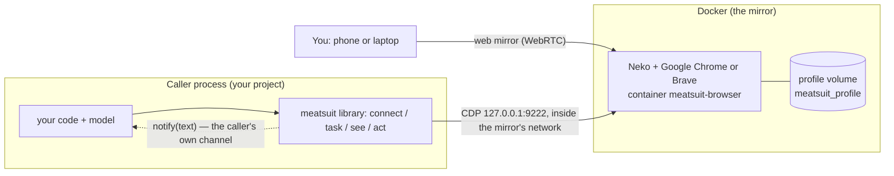

# How meatsuit works

meatsuit is **launching a browser, remembering its session, and eyes and hands** for someone else's code. It decides nothing: the caller (a bot project with its own model and its own credentials) looks at the page and chooses the next command. This page explains the parts and the reasons behind them. The API itself is in [contract.md](contract.md); running the mirror is in [docker/README.md](../docker/README.md).

## The parts

- **The library** runs inside the caller's process (a container next to the mirror, or a laptop). It connects to the browser over CDP and gives the caller `task(name, fn, { site })`; inside, `see()` returns the page as text plus numbered elements and `act(command)` performs one command from a closed set with human-paced mouse and keyboard.
- **The mirror** is Neko with one browser and one persistent profile. A person opens it from an ordinary web page, signs in to sites once, and solves whatever the bot stops on.
- **The profile** lives in a Docker volume (or a host folder), so sign-ins survive restarts and re-creates of the container.

## Credentials come from the caller

meatsuit holds no secrets of the callers and talks to nobody by itself:

| What | Where it comes from |
|---|---|
| site limits | the caller's `sites.json` (`connect({ sitesFile })`) or an object (`connect({ sites })`); the repository has only `sites.example.json` |
| notifications | `connect({ notify })`, an async function of the caller. `telegram.js` is a helper the caller may use; the token and chat are its arguments |
| state (per-site queue locks, counters, journal, the owner's wheel) | `connect({ dir })`. **All callers of one browser use one `dir`**, otherwise two bots enter one site at once and the wheel stops only some of them |
| whether the owner holds the mirror | optional `connect({ ownerPresent })`, the caller's function (it holds the Neko admin password, not meatsuit) |
| site passwords | never: a login page means `NeedsHuman`, and the person signs in through the mirror |

The core reads no environment variables (`test/api.test.js` checks it). Only the mirror has secrets of its own — the Neko passwords — and they live in the deploy file, outside git.

## One browser, many short tasks

`task()` waits while the owner holds the wheel, queues behind its site's lock file in `dir` (works across processes), checks the site's limits, opens its own window (or takes the site's tab with `singleTab`), runs the caller's function under supervision and closes the window. A captcha, a login page, a block or a page off the task's site raises `NeedsHuman`: the task stops and **the window stays open** for the person. Budgets (`maxCommands`, `maxMinutes`) end runaway tasks. `dryRun` lets a caller rehearse on a live site: it sees everything and changes nothing.

Several bots share the one warmed browser, so the queue is **per site**, not per browser:

| | Per site | For the whole browser |
|---|---|---|
| queue «one bot at a time» | yes: `<dir>/queue/<key>.lock`, a site and its subdomains share a key | no: tasks on different sites run at once, each in its own window or tab |
| limits (`sites.json`), hold after `NeedsHuman` | yes; optionally split into reads and writes (`readsPerHour`) | no |
| the owner at the wheel (`<dir>/wheel.json`) | no | yes: while the owner works in the mirror, no task starts, no command starts, and a `fill` or `type` already typing stops within about 2 seconds |

Why the wheel is global and the queue is not: a bot in its own window disturbs no other bot (its commands go over CDP to its own page), but a bot's click activates its window, and the letters the owner is typing in the mirror then land in the bot's field (measured in a local Neko mirror; task windows open in the background, so at least opening one takes no focus). Why a site and its subdomains share a queue: a `singleTab` task finds the site's tab by subdomain too, so a task on `telegram.org` could otherwise take the `web.telegram.org` tab another task is working in. The shared files of `dir` (`limits.json`, `tabs.json`) are changed under a short lock `state.lock`, so concurrent tasks lose no counters. Details and what is not verified: [contract.md](contract.md#several-bots-in-one-browser).

A site may split its budget into reads and writes (`readsPerHour`, optionally `readsPerDay`): a task starts on a read slot, and its first writing command takes a write slot from `perHour` and `perDay` before it runs, so a chat bot that mostly looks at a conversation does not use up its replies by looking. Without `readsPerHour` the limits count as before ([contract.md](contract.md#sitesjson)).

The command set is closed (`click`, `fill`, `type`, `press`, `select`, `upload`, `scroll`, `wait`, `back`, `goto`): no arbitrary JavaScript, `goto` stays on the task's site, and `upload` takes files only from the task's `uploadDirs`. Clicks check that the target is really under the cursor before pressing; typing checks the focus, and afterwards that the field holds what was asked for (`FieldMismatch` otherwise, and Enter into that field is refused).

## The deploy file and the config page

The mirror's settings — passwords, address and ports, browser and image tag, profile folder, time zone, CPU and memory ceilings — are one git-ignored file, `docker/.env` or the file `MEATSUIT_CONFIG` points to. Callers' settings are not there: the library runs in the caller's process and could not read a file on the server anyway.

- `npm run init` writes the file once (mode 0600, random hex passwords) and never overwrites it.
- `npm run config` is a temporary process on the host. It is deliberately not part of any container: the browser in the mirror opens arbitrary pages, so anything reachable from the browser's network could be attacked from a page. The config page listens on `127.0.0.1`, needs a one-time token sent in a header (no cookies), checks `Origin` and `Host`, never sends password values to the page, writes atomically with mode 0600, refuses with `409` if the file changed meanwhile, and exits when idle.
- `docker/up.sh` hands the file to `docker compose --env-file`.

## Choosing the browser

Google Chrome is the default because existing sign-ins were made in it; Brave is the alternative. They need different images, supervisord configs, policy paths and profile folders, so each has its own small compose file (`docker/browser-chrome.yml`, `docker/browser-brave.yml`) that the main `docker-compose.yml` extends according to `MEATSUIT_BROWSER`. Each browser has its own profile volume: a profile is not portable between them, and switching means signing in again.

The names other stacks depend on never change: the container `meatsuit-browser` (attach with `network_mode: "container:meatsuit-browser"`) and the Chrome profile volume `meatsuit_profile`. CDP listens only on `127.0.0.1` inside that network namespace and is never published.

## Leaks into git, closed systematically

`tools/secret-scan.sh` (no dependencies) runs before `npm test` and, optionally, as a pre-commit hook. It looks for typical keys and tokens, Neko passwords with a value, tailnet names and addresses, real ASNs, `ssh user@host` with a real host, and files that must not be tracked (deploy files, personal configs, archives). Personal words no pattern can know go into a git-ignored `.secret-scan.local`.

## `extras/`: services around the core

An earlier line of the project built an HTTP service (`GET /view`, `POST /act`) with its own queue and limits, a warm-up scheduler and an egress check. They live in `extras/` with their own copies of the modules they need, and they are a maintained part of the project: the owner develops them, and their tests run with `npm run test:extras`. One rule stays: the core library loads nothing from `extras/`, and `test/api.test.js` enforces it, so the library keeps working without them. Their documents: [http-api.md](http-api.md), [warmup.md](warmup.md), the egress check in [egress.md](egress.md#the-egress-check). In Docker they are the optional profiles `api` and `warmup`.

The owner's stealth review of 20.10.2026 was done on this line and lives in `extras/`: a human reaction pause before every action (`extras/human/pace.js`), the guard checked before an action as well as after, a `hover` action, a task or warm-up window sized like the owner's (`extras/window.js`), owner presence through the Neko API (`extras/presence.js`, `503 owner_present`), one browser lock shared by the service and warm-up (`extras/lease.js`, `503 browser_busy`, state in `data/browser.lock`), a minute of re-checks before an undetermined exit closes a task, and `extras/selfcheck.js`. Details: [stealth.md](stealth.md), [http-api.md](http-api.md), [warmup.md](warmup.md).

## What is verified

The status table in the [README](../README.md#status) is the one place for it; open items are in [ROADMAP.md](ROADMAP.md).
